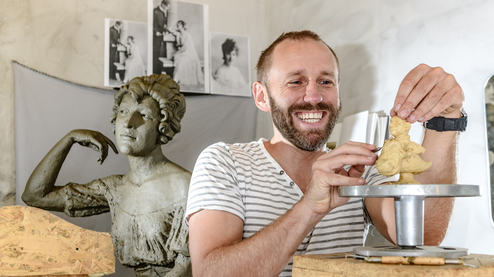
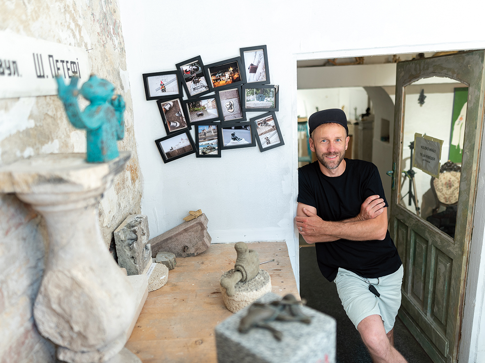
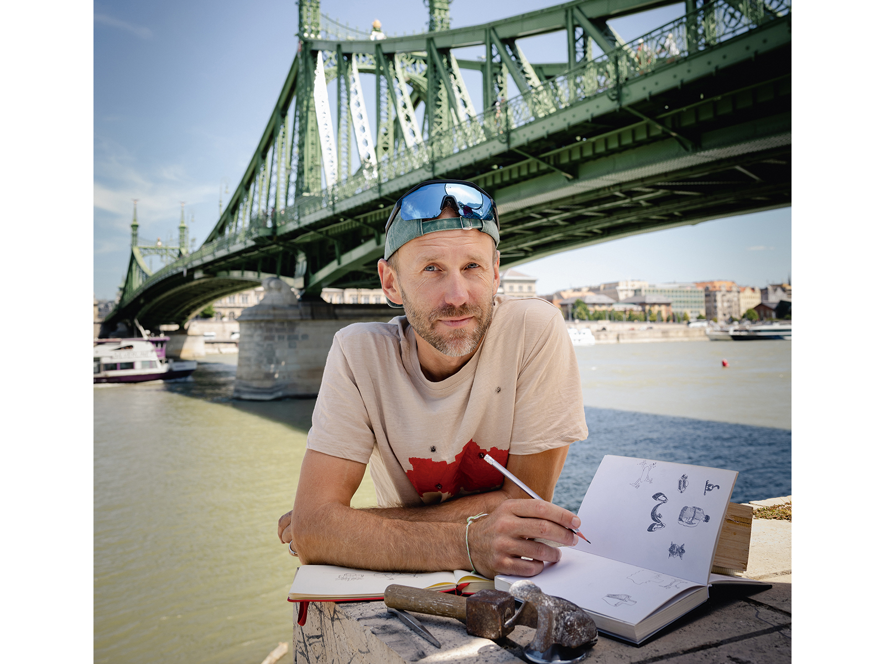
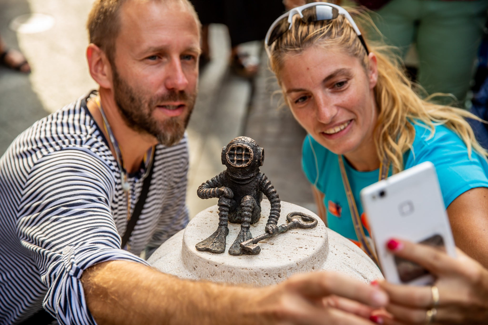
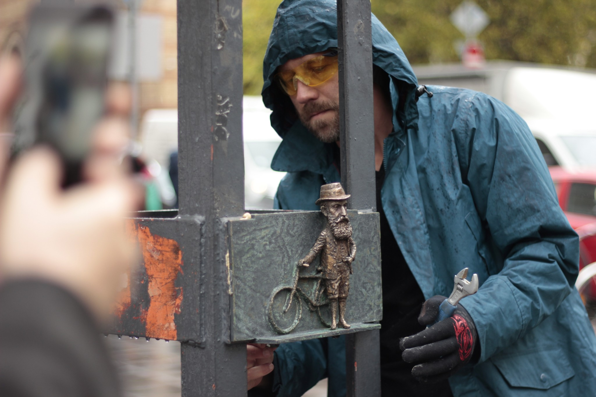
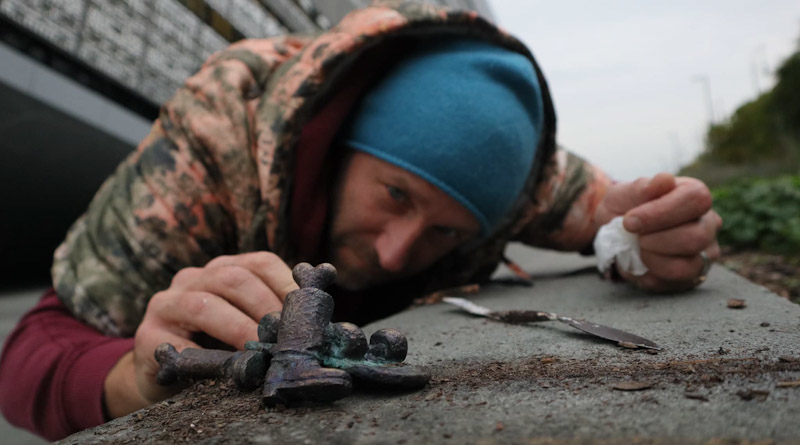
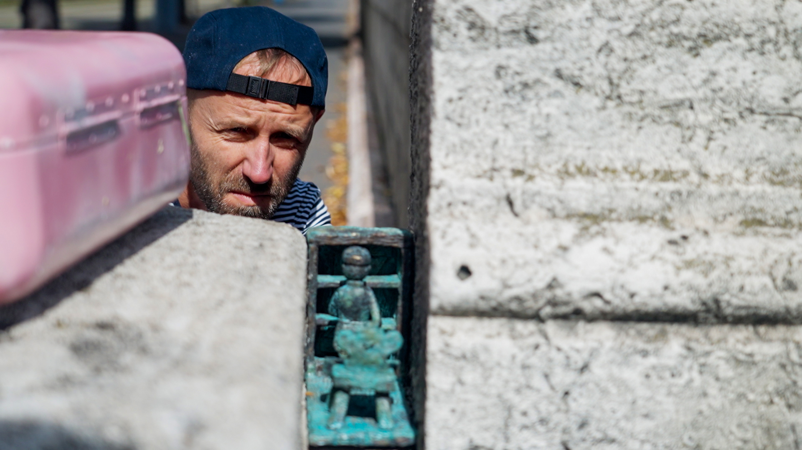

# Kolodko Mihàly

## Bevezetés

**Kolodko Mihály napjaink egyik különleges és sokak által kedvelt művésze, akinek neve egyre több ember számára ismerősen cseng. Különlegességét az adja, hogy alkotásai nem csupán a művészet iránt érdeklődőket szólítják meg, hanem a hétköznapi emberek figyelmét is felkeltik. Személye és művészete sokak számára azért érdekes, mert képes meglepetést és örömet vinni az emberek mindennapjaiba.
Kolodko Mihály ukrán származású, Magyarországon is ismertté vált művész.**

**Budapesten számos olyan apró alkotás található, amely mosolyt csal az emberek arcára. Ezek a kis szobrok gyakran váratlan helyeken bukkannak fel, ezért a járókelők számára felfedezésük igazi élményt jelenthet. Sokan fényképeket készítenek róluk, és megosztják azokat az interneten is.**

**A művész alkotásai azért is népszerűek, mert humorosak, ötletesek, és gyakran ismert mesékhez, történelmi személyekhez vagy a magyar kultúrához kapcsolódnak. Munkái arra ösztönzik az embereket, hogy nyitott szemmel járjanak, és a megszokott környezetükben is észrevegyék a különlegességeket.**

**Véleményem szerint Kolodko Mihály azért is figyelemre méltó, mert megmutatja, hogy a művészet nemcsak múzeumokban létezhet, hanem az utcákon is. Apró szobrai színesebbé és izgalmasabbá teszik a városi életet, miközben mosolyt csalnak az emberek arcára.**

## Tanulmányai
**Kolodko Mihály ukrán származású szobrászművész, aki tanulmányai során a művészet és a szobrászat világával ismerkedett meg. 1978-ban született Ungváron, Kárpátalján. Már fiatal korában érdeklődött a művészet iránt, ezért olyan tanulmányokat folytatott, amelyek segítségével fejleszthette kreativitását és művészi képességeit.**

**Tanulmányait az Ungvári Iparművészeti Főiskolán végezte, ahol szobrászatot tanult. Az intézményben elsajátította a szobrászat alapvető technikáit, megismerkedett a különböző anyagok felhasználásával, valamint a formák és arányok kialakításának módszereivel. Ezek az ismeretek fontos alapot jelentettek későbbi művészi pályájához.**

**Tanulmányai során nemcsak a hagyományos szobrászat iránt érdeklődött, hanem saját ötleteinek megvalósítására is törekedett. Később egyedi látásmódja és kreativitása hozzájárult ahhoz, hogy kialakítsa sajátos művészi stílusát.**

**Kolodko Mihály példája jól mutatja, hogy a megfelelő szakmai képzés és a kitartó tanulás fontos szerepet játszhat egy művész fejlődésében. Tanulmányai során megszerzett tudása később lehetővé tette számára, hogy különleges, apró méretű szobrokat alkosson, amelyekkel sok ember figyelmét felkeltette.**

## Munkássága
**Kolodko Mihály ukrán származású szobrászművész, aki különleges, apró méretű szobraival vált ismertté Magyarországon. Alkotásai főként Budapest utcáin és terein találhatók meg, de más magyar városokban is felfedezhetők. Műveinek egyik legfontosabb jellemzője, hogy kicsik, mégis jelentős mondanivalót hordoznak.**

**Szobrait gyakran miniszobroknak nevezik. Ezek az alkotások sokszor ismert mesefigurákat, történelmi személyeket, híres filmek szereplőit vagy a magyar kultúrához kapcsolódó alakokat ábrázolnak. Műveiben gyakran jelenik meg a humor, az irónia és a társadalomkritika. Egyes szobrai egy-egy történelmi eseményre vagy közéleti jelenségre utalnak, mások egyszerűen mosolyt csalnak az emberek arcára.
Kolodko Mihály alkotásainak különlegessége, hogy nem hagyományos kiállítótermekben, hanem a városi környezetben találhatók.**

**Emiatt a járókelők egy váratlan pillanatban is felfedezhetik őket. A miniszobrok keresése sokak számára izgalmas városi kalanddá vált.
Munkássága új megközelítést ad a köztéri művészetnek, hiszen bebizonyítja, hogy egy apró alkotás is képes gondolatokat ébreszteni és érzelmeket kiváltani. Szobrai Budapest látképének különleges részévé váltak.**

